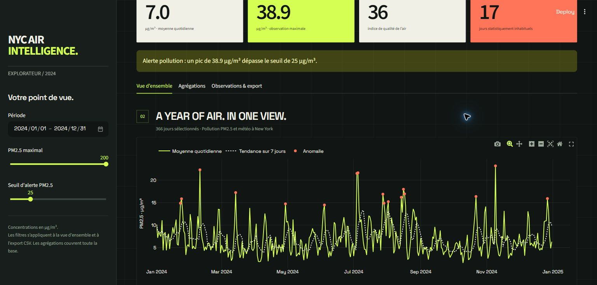
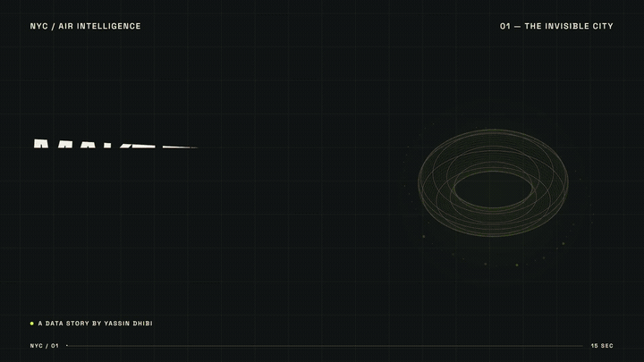
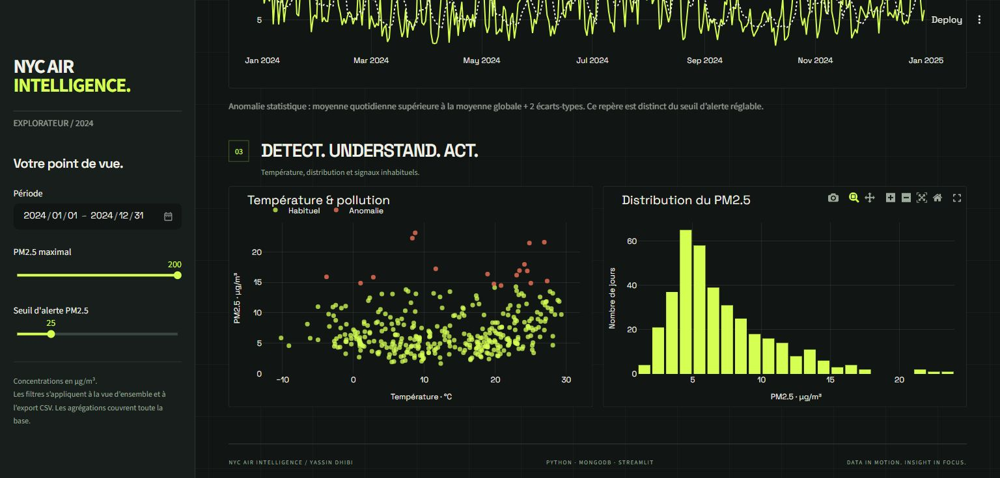
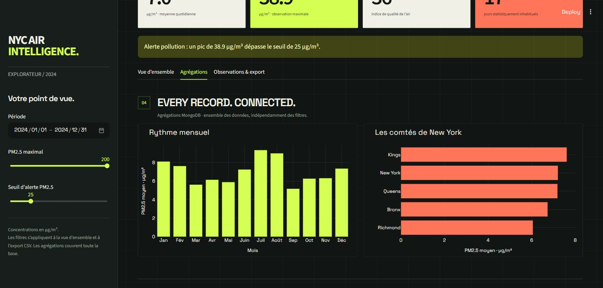
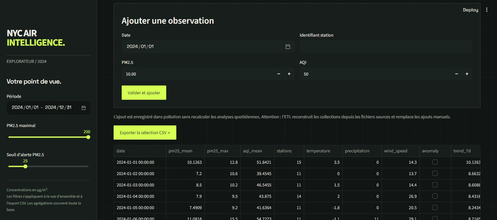
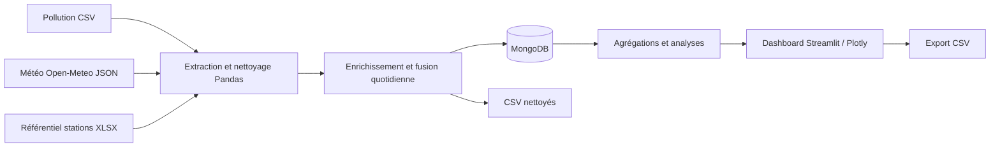

<div align="center">

# NYC AIR INTELLIGENCE

**MAKE THE INVISIBLE VISIBLE.**

Une année de pollution et de météo à New York, transformée en informations explorables.

**Python · Pandas · MongoDB · Streamlit · Plotly**

[Installation](#installation) · [Guide illustré](#guide-illustré) · [Architecture](#architecture) · [Vidéo](#vidéo-du-projet)

</div>



## Le projet

NYC Air Intelligence est un projet de 3ème LIG-BI consacré à l’analyse intelligente de données environnementales. Il relie les observations de particules fines **PM2.5**, la météo quotidienne et un référentiel de stations pour explorer les variations de qualité de l’air à New York en **2024**.

Le parcours est complet : **collecter → nettoyer → enrichir → stocker → analyser → visualiser**. Le dashboard reprend l’identité visuelle du film : fond sombre quadrillé, typographie Space Grotesk, accents citron vert et corail, et motif filaire animé.

| Dans le jeu de données présenté | Valeur |
|---|---:|
| Mesures de pollution après nettoyage | **5 212** |
| Journées analysées | **366** |
| Formats sources lus par l’ETL | **CSV + JSON + XLSX** |
| Collections MongoDB | **3** |
| Indicateurs / graphiques | **4 / 5** |

Ces valeurs décrivent le jeu 2024 utilisé pour les captures et le film. Les indicateurs à l’écran évoluent avec les filtres et les données chargées.

## Vidéo du projet

**15 secondes · 1920 × 1080 · 60 images/s · musique originale**

Cliquez sur l’aperçu animé pour ouvrir le fichier vidéo. Le GIF est une version légère et silencieuse ; le MP4 contient la musique et la qualité complète.

[](docs/media/nyc-air-intelligence.mp4)

**[▶ Ouvrir la vidéo MP4](docs/media/nyc-air-intelligence.mp4)**

Si GitHub ne propose pas de lecture intégrée, utilisez **Download raw file** sur la page du MP4 pour le lire localement. L’accès aux médias suit les permissions du dépôt.

## Fonctionnalités

- **4 KPI** : PM2.5 moyen, pic PM2.5, AQI moyen et nombre de jours inhabituels.
- **5 graphiques interactifs** : série temporelle et tendance sur 7 jours, température/pollution, distribution, agrégation mensuelle et comparaison des comtés.
- **Filtres** : période, PM2.5 quotidien maximal et seuil d’alerte réglable.
- **Détection statistique** : jours au-dessus de la moyenne globale + 2 écarts-types.
- **Formulaire validé** : ajout d’une observation dans MongoDB.
- **Export CSV** : téléchargement de la sélection courante.

## Installation

### Prérequis

- Python **3.10 ou plus récent**, avec `venv` et `pip`.
- Git et accès à ce dépôt privé.
- Docker Desktop **démarré**, avec les conteneurs Linux, ou un serveur MongoDB accessible.
- Une connexion Internet pour installer les dépendances, télécharger l’image MongoDB et récupérer la météo Open-Meteo lors de l’ETL.

### 1. Cloner et installer — Windows / PowerShell

```powershell
git clone https://github.com/YassinDhibi/nyc-air-intelligence.git
cd nyc-air-intelligence
python -m venv .venv
.\.venv\Scripts\python.exe -m pip install -r requirements.txt
```

Les commandes utilisent directement le Python de l’environnement virtuel : aucune modification de la politique PowerShell n’est nécessaire.

### 2. Démarrer MongoDB et préparer les données

```powershell
docker compose up -d
.\.venv\Scripts\python.exe scripts/run_etl.py
```

Les fichiers de pollution et de stations sont fournis dans `data/raw/`. L’ETL télécharge la météo, l’enregistre en JSON, lit les trois formats, produit les CSV nettoyés dans `data/processed/`, puis charge MongoDB et crée ses index.

Une exécution sur le jeu présenté affiche notamment :

```text
Formats lus: CSV (pollution), JSON (météo), XLSX (référentiel stations)
MongoDB: 5212 366 366
```

> **Rechargement des données :** `run_etl.py` remplace les collections `pollution`, `weather` et `daily_analysis` à partir des sources. Les observations saisies uniquement via le formulaire ne sont pas conservées lors de ce rechargement. Exportez ou sauvegardez vos ajouts avant de relancer l’ETL.

### 3. Ouvrir le dashboard

```powershell
.\.venv\Scripts\python.exe -m streamlit run app.py
```

Ouvrez **http://localhost:8501**. Pour arrêter l’application : `Ctrl+C`. Pour arrêter MongoDB sans supprimer son volume :

```powershell
docker compose stop
```

<details>
<summary>Commandes macOS / Linux</summary>

```bash
git clone https://github.com/YassinDhibi/nyc-air-intelligence.git
cd nyc-air-intelligence
python3 -m venv .venv
.venv/bin/python -m pip install -r requirements.txt
docker compose up -d
.venv/bin/python scripts/run_etl.py
.venv/bin/python -m streamlit run app.py
```

</details>

<details>
<summary>Utiliser un autre serveur MongoDB</summary>

Les valeurs par défaut sont `mongodb://localhost:27017` et la base `nyc_environment`. Pour les personnaliser en PowerShell, définissez les variables avant l’ETL et le lancement de Streamlit :

```powershell
$env:MONGO_URI = "mongodb://localhost:27017"
$env:MONGO_DB = "nyc_environment"
```

La configuration lit les variables d’environnement du processus ; un fichier `.env` seul n’est pas chargé automatiquement. Ne placez pas d’identifiants de connexion dans le dépôt.

</details>

## Guide illustré

### 1. Choisir une période et lire les indicateurs

Dans la barre latérale **Votre point de vue.**, choisissez les dates de début et de fin. Le curseur **PM2.5 maximal** exclut les journées dont la moyenne dépasse la valeur choisie. Les quatre cartes résument la sélection.

Le **Seuil d’alerte PM2.5** déclenche une alerte lorsque le pic de la sélection atteint ou dépasse ce seuil. Il ne change pas le calcul des anomalies statistiques.


### 2. Explorer les tendances et les anomalies

Dans **Vue d’ensemble**, survolez la courbe pour voir les valeurs quotidiennes. La ligne claire représente la tendance sur 7 jours et les points corail signalent les anomalies. Les deux graphiques suivants montrent la relation température/pollution et la distribution des concentrations.

Vous pouvez zoomer dans les graphiques Plotly ; utilisez **Reset axes** pour revenir à la vue complète.



### 3. Comparer les mois et les comtés

Ouvrez **Agrégations** pour comparer les moyennes mensuelles et géographiques. Ces graphiques utilisent les pipelines d’agrégation MongoDB et couvrent **toute la base**, indépendamment des filtres de la barre latérale.



### 4. Ajouter une observation et exporter

Dans **Observations & export** :

1. Renseignez la date et un identifiant de station non vide.
2. Saisissez le PM2.5 et l’AQI, puis cliquez sur **Valider et ajouter**.
3. Pour télécharger les analyses filtrées, cliquez sur **Exporter la sélection CSV ↗**. Le tableau en dessous permet de consulter ces mêmes données.

L’ajout est enregistré dans la collection `pollution`. Il ne recalcule pas automatiquement les analyses quotidiennes et ne figure donc pas immédiatement dans l’export de `daily_analysis`. Le rechargement ETL repart des fichiers sources, comme indiqué dans la section Installation.



## Architecture



```text
nyc-air-intelligence/
├── app.py                  # Dashboard, filtres, formulaire et export
├── .streamlit/config.toml  # Thème Streamlit
├── assets/                 # Styles et police locale du dashboard
├── src/
│   ├── config.py           # Chemins et paramètres MongoDB
│   ├── extract.py          # Lecture CSV / JSON / XLSX et API météo
│   ├── transform.py        # Nettoyage, fusion, tendance et anomalies
│   ├── database.py         # Collections, index et agrégations
│   └── presentation.py     # Identité visuelle et styles des graphiques
├── scripts/run_etl.py      # Pipeline de préparation et chargement
├── data/raw/               # Fichiers sources
├── data/processed/         # Sorties générées localement
├── tests/                  # Tests de transformation
├── docs/images/            # Captures du guide
├── docs/media/             # Film MP4 et aperçu GIF
├── docker-compose.yml      # MongoDB 7 et volume persistant
└── requirements.txt
```

### Collections et indicateurs

| Élément | Rôle |
|---|---|
| `pollution` | Observations PM2.5/AQI enrichies avec les stations et comtés |
| `weather` | Température moyenne, précipitations et vent par jour |
| `daily_analysis` | Fusion quotidienne, indicateurs, moyenne mobile et anomalie |
| PM2.5 moyen | Moyenne des moyennes quotidiennes dans la sélection |
| Pic PM2.5 | Plus forte observation quotidienne de la sélection |
| AQI moyen | Moyenne des AQI quotidiens dans la sélection |
| Anomalies | Nombre de jours marqués par le seuil statistique global |

Les unités PM2.5 sont en **µg/m³**. L’AQI et les anomalies sont des indicateurs distincts : le seuil statistique ne constitue pas une catégorie sanitaire officielle.

## Données et crédits

- **Pollution** : observations quotidiennes AQS pour New York en 2024, fichier `data/raw/pollution_nyc_2024.csv`.
- **Météo** : API historique Open-Meteo, coordonnées `40.7128, -74.0060`, fuseau `America/New_York`, du 1er janvier au 31 décembre 2024 ; JSON dans `data/raw/weather_nyc_2024.json`.
- **Stations** : référentiel Excel `data/raw/stations_nyc.xlsx`, feuille `stations`, utilisé pour enrichir la pollution.
- **Design** : palette et motifs du film NYC Air Intelligence ; Space Grotesk distribuée avec sa [licence SIL Open Font License](assets/fonts/OFL.txt).
- **Film** : animation Remotion, React et SVG ; composition musicale originale synthétisée, sans piste de stock.

## Tests et dépannage

```powershell
.\.venv\Scripts\python.exe -m pytest -q
```

| Situation | Action |
|---|---|
| « MongoDB indisponible » | Démarrer Docker Desktop, puis `docker compose up -d`. Vérifier `docker compose ps` et `MONGO_URI`. |
| Base vide | Exécuter `scripts/run_etl.py` une première fois et vérifier sa sortie. |
| Échec de récupération météo | Vérifier la connexion Internet et l’accès à Open-Meteo, puis relancer l’ETL. |
| Aucun jour sélectionné | Élargir la période ou augmenter le PM2.5 maximal. |
| Port 8501 occupé | Ajouter `--server.port 8502` à la commande Streamlit et ouvrir le nouveau port. |
| Station refusée dans le formulaire | Fournir un identifiant de station non vide. |

## Correspondance avec le cahier des charges

| Exigence | Réalisation |
|---|---|
| Sources hétérogènes | CSV pollution, JSON météo et XLSX stations |
| ETL modulaire | `extract.py`, `transform.py`, `run_etl.py` |
| Stockage et requêtes | MongoDB : trois collections, index, insertion et deux agrégations |
| Préparation Pandas | Conversion, valeurs manquantes, dédoublonnage, filtrage, fusion et statistiques |
| Indicateurs et visualisations | Quatre KPI et cinq graphiques Plotly |
| Interface interactive | Filtres, formulaire validé et export CSV |
| Anomalies et tendance | Moyenne + 2 écarts-types et moyenne mobile 7 jours |
| Alerte configurable | Comparaison du pic PM2.5 au seuil choisi |

---

**Yassin Dhibi · Business Intelligence**
*Data in motion. Insight in focus.*
